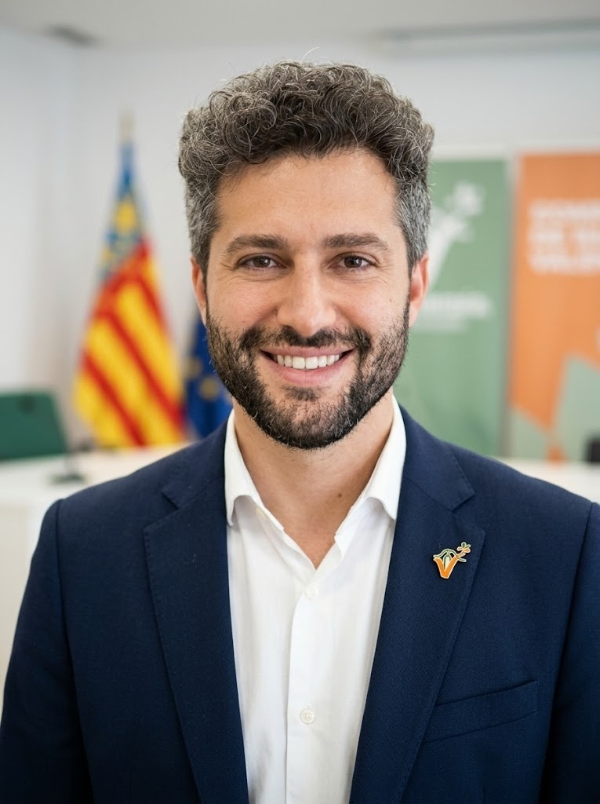

# Som Valldigna

  

  <strong>Partit Polític Regionalista de la Valldigna</strong>

---

## 🏛️ Sobre Som Valldigna

**Som Valldigna** és una formació política d'àmbit local i comarcal, compromesa amb la defensa dels interessos, la identitat, el patrimoni i el progrés de la Valldigna i la seua ciutadania.

---

## 👤 Candidatura

  

  <em>Candidat de Som Valldigna</em>

---

## 📌 Ideologia Política
- **Regionalisme / Localisme**: Prioritzem les necessitats reals i el benestar dels municipis de la Valldigna.
- **Defensa del Patrimoni i la Cultura**: Protecció i difusió de la cultura, la llengua, la història i les tradicions de la comarca.
- **Sostenibilitat i Desenvolupament Local**: Impuls de l'economia local, l'agricultura, el comerç de proximitat i la conservació del medi natural.
- **Proximitat i Transparència**: Una política accessible, participativa i al servei directe de les veïnes i veïns.

---

  <em>Treballant pel present i el futur de la nostra terra.</em>

