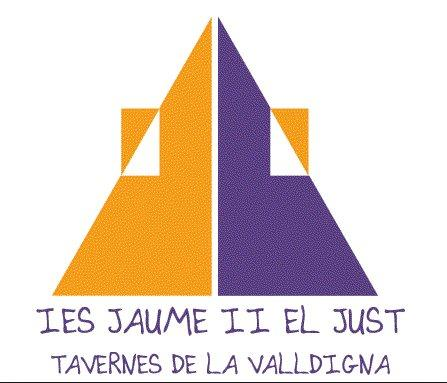
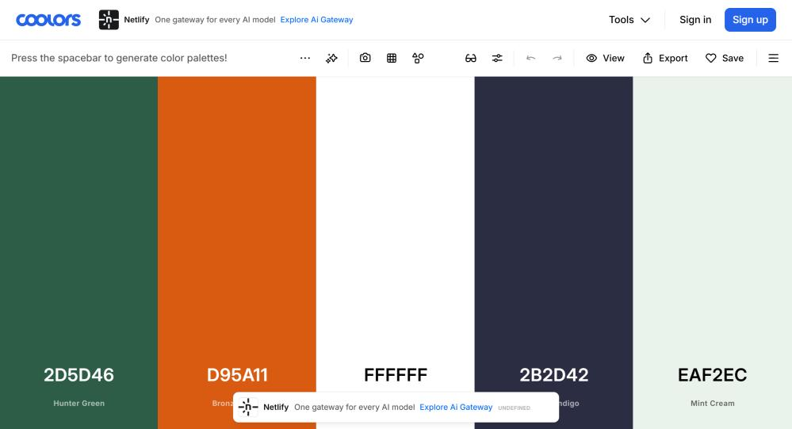
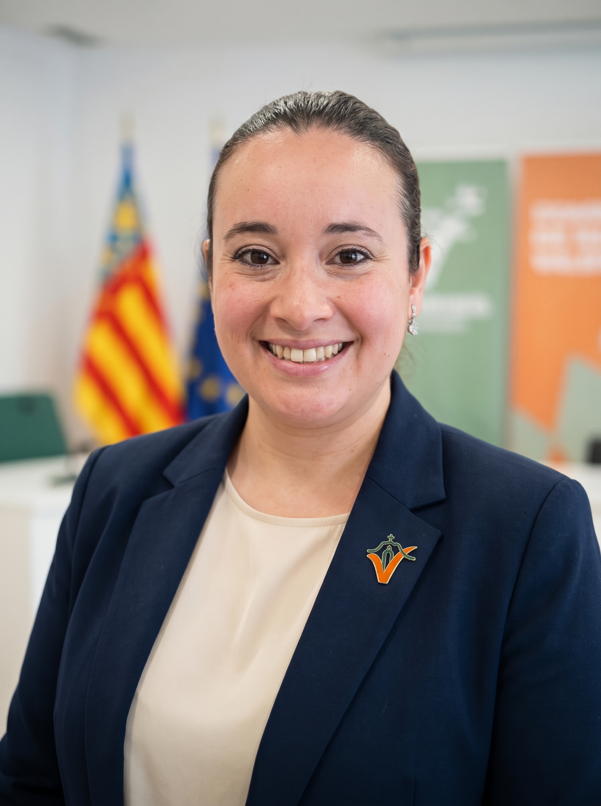
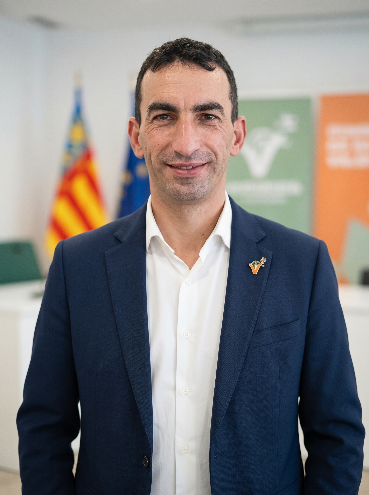
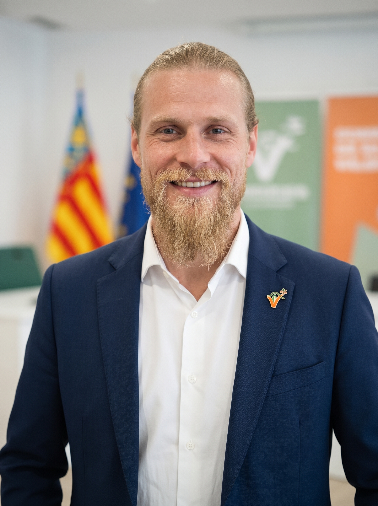
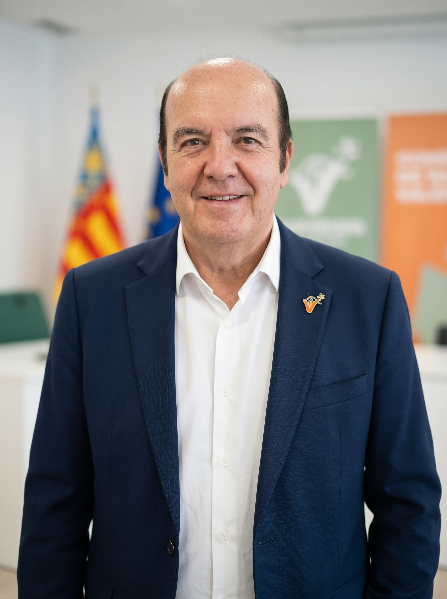
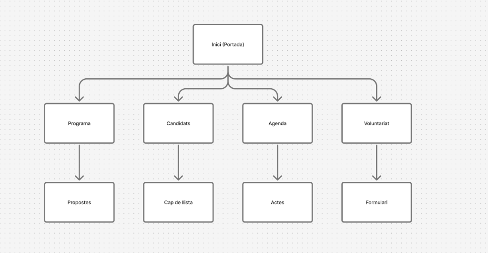
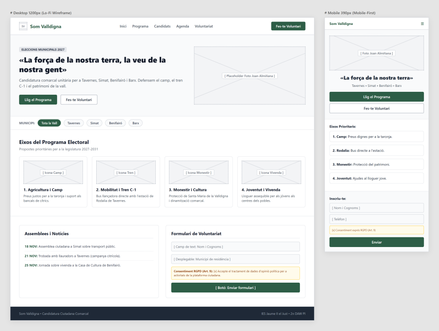
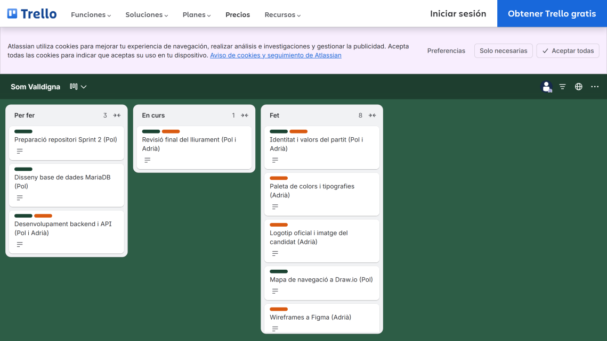

  

<h1 align="center">SPRINT 1 — SOM VALLDIGNA</h1>

  <strong>IES JAUME II EL JUST (Tavernes de la Valldigna)</strong> 
  <em>Projecte Intermodular (PI) — 2n DAW · Curs 2026-2027</em> 
  <strong>Alumnes:</strong> Pol Plana Boivin i Adrià Espí Ripoll

---

## 1. Identitat Visual i Branding del Partit

### Manual d'Estil Bàsic / Brandbook:

#### Nom ficcionat, eslògan i ideologia:
El partit és **Som Valldigna (SV)**, amb l'eslògan *«La força de la nostra terra, la veu de la nostra gent»*. És una plataforma ciutadana comarcal per a Tavernes, Simat, Benifairó i Barx, centrada en la defensa del camp i cítrics locals, transport públic digne amb connexió a Rodalia C-1, protecció del patrimoni del Monestir i vivenda assequible per a jóvens.

#### Psicologia del Color:
Paleta contrastada segons **WCAG 2.1 AA**:
- **Verd Monestir (`#2D5D46`)**: Identitat institucional i capçaleres (contrast 5.8:1).
- **Taronja Valldigna (`#D95A11`)**: Crides a l'acció (CTA).
- **Blanc pur (`#FFFFFF`)**: Fons.
- **Gris Pissarra (`#2B2D42`)**: Text per a una lectura còmoda.

  

#### Tipografia i Logotip:
- **Tipografies:** `Montserrat` per a titulars i `Inter` per al cos de text per la seua bona llegibilitat en pantalles i suport al valencià.
- **Logotip:** El logotip oficial integra la **'V' taronja** de la vall, **l'arc del monestir** en verd i el **perfil de la muntanya**:

  &nbsp;&nbsp;&nbsp;&nbsp;&nbsp;&nbsp;&nbsp;&nbsp;
  

---

## 👥 Candidatura i Equip Comarcal

L'equip de **Som Valldigna** compta amb representació directa de veïnes i veïns dels quatre municipis de la comarca:

   
  <strong>1. Joan Almiñana i Vercher</strong> 
  <em>Cap de Llista i Portaveu Comarcal</em>

<table align="center" width="100%">
  <tr>
    <td align="center" width="25%" valign="top">
       
      <strong>2. Maria Fons i Pellicer</strong> 
      <em>Simat · Patrimoni Cultural i Monestir</em>
    </td>
    <td align="center" width="25%" valign="top">
       
      <strong>3. Vicent Gascón i Palomares</strong> 
      <em>Benifairó · Sector Agrari i Cítrics</em>
    </td>
    <td align="center" width="25%" valign="top">
       
      <strong>4. Elena Boix i Mascarell</strong> 
      <em>Tavernes · Joventut i Ocupació</em>
    </td>
    <td align="center" width="25%" valign="top">
       
      <strong>5. Carles Vidal i Mahiques</strong> 
      <em>Barx · Medi Ambient i Mobilitat</em>
    </td>
  </tr>
</table>

---

## 2. Arquitectura de la Informació i Prototip

### Mapa de Navegació de la Web:
La web s'organitza en **5 seccions clau** enllaçades des de la navegació:
1. **Inici:** Amb el lema de campanya i filtre comarcal.
2. **Programa Electoral:** Amb els eixos prioritaris.
3. **Candidats:** Amb el cap de llista i la candidatura comarcal.
4. **Agenda:** Amb les assemblees als pobles.
5. **Formulari de Voluntariat:** Amb consentiment explícit segons el RGPD Art. 9.

El mapa s'ha dissenyat directament a **Figma / FigJam** (tauler accessible a [figma.com/board/qJI6kz1SUqbSurcS13JdXg](https://figma.com/board/qJI6kz1SUqbSurcS13JdXg)):

  

---

## Wireframes a Figma

### Wireframes de baixa fidelitat a Figma:
S'han dissenyat els esquemes bàsics a Figma seguint un enfocament **Mobile-First (390px)** i la seua adaptació a **escriptori Desktop (1200px)**, utilitzant caixes per a estructurar la disposició dels elements abans de començar a programar:

  

---

## 3. Organització de l'Equip i Treball Col·laboratiu

### Tauler de Tasques i Repartiment de Rols:
El repartiment de responsabilitats entre els dos alumnes és el següent:
- **Pol Plana Boivin:** Arquitectura de la informació a FigJam, redacció de requisits, casella de protecció de dades (RGPD Art. 9) i administració del tauler a Trello.
- **Adrià Espí Ripoll:** Identitat visual de marca, disseny dels wireframes a Figma i integració del logotip oficial.

La gestió i seguiment de les tasques s'ha realitzat mitjançant el tauler Kanban en **Trello** ([trello.com/b/QovdwhOI](https://trello.com/b/QovdwhOI)) organitzat en les llistes *Backlog*, *In Progress*, *Review* i *Done*:

  

